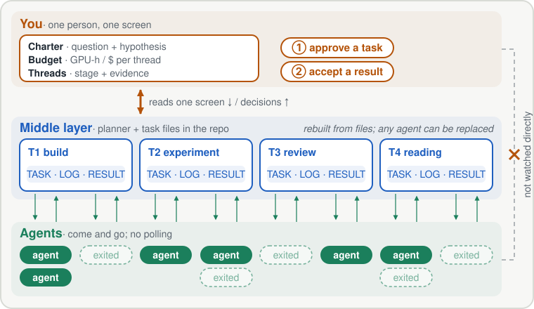

<h1 align="center">Swarm Oversight Harness</h1>

<p align="center"><strong>Oversee many coding agents on a long project from one screen.</strong></p>

<p align="center">
  <a href="https://cogito233.github.io/blog/human-in-the-loop-oversight/">Blog post (why)</a> · <a href="README_zh.md">中文</a> · <a href="MANUAL.md">Manual</a>
</p>

<p align="center">
  
</p>

Swarm Oversight Harness is a set of Markdown conventions and Agent Skills for running many agents on one project for months. You keep a one-screen view of the project and make two kinds of decision. A planner agent keeps task files in the repo up to date, and worker agents pick up a task, do their part, and exit. It has no runtime or service, and it works with Claude Code, Codex, or any agent that can read files.

## Install

Paste into Claude Code, Codex, or Cursor:

```
Install Swarm Oversight Harness from https://github.com/cogito233/swarm-oversight-harness — follow its INSTALL.md.
```

Then try:

```
Set up swarm oversight in this repo.
Move thread T1 forward: have the planner split it, dispatch workers, verify, and update STATE.
What's in the accept queue? Red-team the top item before I sign.
```

## How it works

1. **Setup** creates the files the project is missing: `CHARTER` (question and hypothesis), `STATE` (one row per thread, with budget), `DECISIONS`, and `JOURNAL`.
2. **You approve a task** that the planner drafts in `TASK.md`: its goal, which files it may touch, its acceptance checks, and its budget.
3. **Agents work on the task, not in their own context.** They append to the task's `LOG` and write a `RESULT`. An agent that launches a long experiment writes a handoff and exits instead of polling.
4. **A verifier re-runs the checks**, and the planner updates `STATE`.
5. **You accept the result.** From then on, other work builds on it.

The [blog post](https://cogito233.github.io/blog/human-in-the-loop-oversight/) explains why the work is organized this way, with a worked example of the one-screen view.

## What's inside

| Skill | Use it when |
|---|---|
| [`swarm-setup`](skills/swarm-setup/SKILL.md) | Starting a project or adding the harness to an existing repo |
| [`swarm-loop`](skills/swarm-loop/SKILL.md) | Running one planner round: resync, split, dispatch, verify, update STATE |
| [`swarm-accept`](skills/swarm-accept/SKILL.md) | Before you sign a result: check evidence, red-team, one-screen brief |
| [`swarm-complexity-audit`](skills/swarm-complexity-audit/SKILL.md) | The system works but you keep babysitting it |
| [`swarm-paper`](skills/swarm-paper/SKILL.md) | Pre-submission editing pass for a paper written with agents |

[MANUAL.md](MANUAL.md) has the full rules and profiles (`research`, `experiments`, `product-eng`, `solo`). Templates are in `skills/*/templates/`.

## Core rules

- The worker never certifies its own work; a separate verifier re-runs the checks.
- Edited, committed, launched, ran OK, verified, and accepted are reported separately. Anything without evidence is `unknown`.
- Execution problems are retried within budget. A plan that contradicts reality, or a task about to exceed its budget, goes back to you.
- Logs are append-only, and stale docs are marked stale instead of being trusted silently.

## Limitations

- It is a protocol, and nothing enforces it in code. For execution-layer enforcement, see tools such as [agentsh](https://github.com/canyonroad/agentsh).
- It comes from one person's research projects over about four months, not from a controlled study.
- It is not meant for one-off chores.

## Related work

[Anthropic: long-running agent harnesses](https://www.anthropic.com/engineering/effective-harnesses-for-long-running-agents) ·
[DeepSeek Super-agent](https://github.com/deepseek-ai/dsh-superagent-prototype) ·
[Agensh](https://arxiv.org/abs/2609.26781) ·
[Evolving Agent Teams](https://www.alphaxiv.org/abs/2610.36848) ·
[GitSwarm](https://arxiv.org/abs/2610.04862) ·
[Park & Choi, progress mirage](https://arxiv.org/abs/2607.25152).
BibTeX: [docs/references.bib](docs/references.bib). Not affiliated with any of these projects.

## Citation

```bibtex
@software{lyu2026swarmoversight,
  title  = {Swarm Oversight Harness},
  author = {Lyu, Zhiheng},
  year   = {2026},
  url    = {https://github.com/cogito233/swarm-oversight-harness}
}
```

MIT License. History: [CHANGELOG.md](CHANGELOG.md), [DECISIONS.md](DECISIONS.md).
