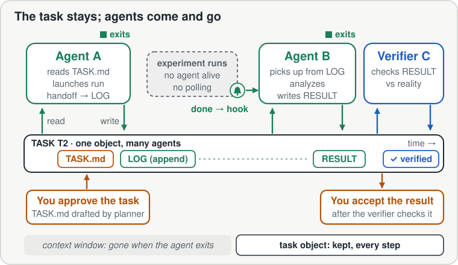

<h1 align="center">Swarm Oversight Harness</h1>

<p align="center"><strong>One person overseeing many agents on a project that runs for months.</strong></p>

<p align="center">
  <a href="README.md">English</a> | <a href="README_zh.md">中文</a>
</p>

**Background and motivation:** [Toward Human-in-the-Loop Oversight for Long-Horizon Agent Projects](https://cogito233.github.io/blog/human-in-the-loop-oversight/) (blog post).

Running ten agents at once is easy. Overseeing them on one project for three months is harder, because after a few weeks the bottleneck is knowing what is true in your own project. Swarm Oversight Harness puts a middle layer between you and the agents. You look at one screen and make two kinds of decision. The middle layer, which consists of task files in the repo and a planner agent that maintains them, turns those decisions into work for many short-lived agents and turns their output back into that screen.

It is a set of plain Markdown docs and Agent Skills: task files in the repo, plus a planner agent that keeps them current. There is no runtime and no service. It works with Claude Code, Codex, or any coding agent that can read files.

<p align="center">
  
</p>

> [!IMPORTANT]
> **Install with your agent.** Paste this into Claude Code, Codex, or Cursor:
> ```
> Install Swarm Oversight Harness from https://github.com/cogito233/swarm-oversight-harness — follow its INSTALL.md.
> ```
> **Then try:**
> ```
> set up swarm oversight in this repo.
> ```
> ```
> Move thread T1 forward: have the planner split it, dispatch workers, verify, and update STATE.
> ```
> ```
> What's in the accept queue? Red-team the top item before I sign.
> ```

## What you see and what you decide

Your view of the project fits on one screen and has three parts:

- **Charter**: the question the project is trying to answer, and the hypothesis whose outcome would change your plans.
- **Budget**: how many GPU-hours and API dollars each thread may spend before it has to come back and ask.
- **Threads**: what each line of work is doing, what stage it has verifiably reached (with evidence), and what it is waiting for.

An illustrative example (not a real project):

```
CHARTER  Can a 7B model learn to check its own patches with repo tests?
         H1: training on fail→pass test pairs adds ≥10 points of
             self-check accuracy on held-out repos.
         Kill if the 200-task pilot gains < 3 points.
BUDGET   2,000 GPU-h + $1,500 API in total. Over a thread's cap → ask.

STATE    critical path: T2 pilot result
  T1 build    fail→pass pipeline    verified, CI #41    40/100 GPU-h   → accept gate
  T2 run      SFT pilot, 200 tasks  launched, no agent  310/400 GPU-h  → done hook
  T3 review   red-team T1 leakage   running             $90/$200
  T4 read     related-work map      draft               $15/$50
```

From this screen you make two kinds of decision:

1. **Approve a task** that the planner has drafted: what it is for, what counts as done, and how much it may spend.
2. **Accept a result** after a verifier has re-run its checks. From then on the result is no longer a draft, and other work builds on it.

Everything below this screen is written for agents. You open a task's files only when one of these two decisions needs them.

## The task is the unit of work

A single agent is easy to follow because it has one linear history, but that history is lost when its context window ends. The middle layer keeps the history in the task instead. A task is a small, durable object in the repo:

- `TASK.md`: the goal, the files it may and must not touch, its authorization and budget, acceptance criteria with how each one is checked, and stop conditions;
- a `LOG` that is only ever appended to, with a snapshot of the current state at the top;
- `RESULT` files with evidence;
- one row in `STATE`, which is the screen above.

Agents attach to a task, do their part, and exit. Any agent can pick up where the last one stopped, because everything it needs is in the task's files.

<p align="center">
  
</p>

**An agent that launches a long experiment exits instead of polling.** Before it exits, it appends a handoff to the task's LOG: what was launched, where the outputs will appear, and how to check them. A completion hook or marker file signals the end of the run, and a new agent picks up the task.

The planner maintains this layer. Each round it re-reads the repo, corrects STATE wherever it disagrees with reality, names one critical path, splits the work into tasks that touch different files, dispatches workers, has their results verified, and consolidates everything into one STATE update.

## Memory: what to trust, what to clean up

Keeping memory in files only helps if the files stay trustworthy. Each piece of memory in the repo belongs to one of four kinds:

| Kind | Examples | Valid as | Kept by |
|---|---|---|---|
| Current | `STATE`, `CHARTER`, open `TASK.md` | what is true now | overwritten; checked against reality every round |
| History | `LOG` entries, old `RESULT`s, `DECISIONS` | what happened | append-only; never edited |
| Stale | a doc older than the code it describes; a superseded plan | nothing until re-checked | marked stale, not silently trusted |
| Disposable | scratch files, an agent's context, unaccepted drafts | nothing | deleted freely |

The planner does the cleanup at the start of each round. When STATE disagrees with git, tests, or run outputs, the planner trusts the repo and fixes STATE. Superseded plans move to history with a pointer to what replaced them. Anything that exists only in an agent's context is treated as gone, because the agent will exit.

## Rules that do the most work

1. **Two human decisions.** You approve tasks and accept results. Everything in between belongs to the planner.
2. **The worker never certifies itself.** A separate verifier re-runs the check named in the task and compares what it sees with what was claimed.
3. **Six facts, reported separately**: edited, committed, launched, ran OK, verified, accepted. Anything without evidence is written as `unknown`.
4. **One critical path per round.** Many agents is fine. Many competing finish lines is not.
5. **Retry HOW, stop on WHAT.** A failing test is retried within budget. A plan that contradicts reality, or a thread about to go over its budget cap, is escalated to you right away.
6. **Suggestions are not authorization.** A task can't create or widen what you authorized, and its budget is part of that authorization.
7. **Dead ends are recorded.** A hypothesis that was killed goes into DECISIONS with its reason, so later agents do not try it again.

## What's inside

| Skill | Use it when |
|---|---|
| [`swarm-setup`](skills/swarm-setup/SKILL.md) | Starting a project, or adding the harness to an existing repo. It inventories existing docs and creates only the missing ones. |
| [`swarm-loop`](skills/swarm-loop/SKILL.md) | Running a planner cycle: resync → one critical path → split into file-disjoint tasks → workers → independent verify → consolidate into STATE. |
| [`swarm-accept`](skills/swarm-accept/SKILL.md) | Before you sign: it checks evidence, red-teams the output, and gives you a one-screen brief. The agent never accepts for you. |
| [`swarm-complexity-audit`](skills/swarm-complexity-audit/SKILL.md) | The system "works" but you are babysitting it. It sorts the complexity into essential, accidental, speculative, or control debt. |
| [`swarm-paper`](skills/swarm-paper/SKILL.md) | Writing a research or benchmark paper with coding agents: a pre-submission editing pass. |

- **[MANUAL.md](MANUAL.md)**: the full operating manual (why each rule exists, profiles, doc hygiene, how project rules flow back upstream).
- **Profiles**: `research` · `experiments` · `product-eng` · `solo`. The core loop is the same in all of them; what "accept" means changes (finding → accepted, run → current best, branch → main).

## Related work

- **Anthropic, [Effective harnesses for long-running agents](https://www.anthropic.com/engineering/effective-harnesses-for-long-running-agents)** (Nov 2025). An initializer agent, a progress file, and git history let one coding agent pick up across context windows. This treats the environment as memory for a single agent. We extend the idea to many agents and add the two human decisions.
- **Zhan et al., [Agensh: Scaling Organizational Intelligence to 1,024 Agents](https://arxiv.org/abs/2609.26781)** (arXiv 2609.26781). Tasks are claimable objects in a shared workspace, and a decentralized team scales to 1,024 agents.
- **Cao et al., [Evolving Agent Teams](https://www.alphaxiv.org/abs/2610.36848)** (arXiv 2610.36848, Oct 2026). A supervisor diagnoses when a team is stuck in a local optimum and restructures it. Teams share a persistent file-system harness made of a learning document and an evolution history. Their supervisor automates restructuring; here a planner does the routine work and the human keeps the WHAT decisions.
- **Shah et al., [GitSwarm: Decentralized Compounding Inference](https://arxiv.org/abs/2610.04862)** (arXiv 2610.04862). Homogeneous agents build on each other's intermediate work through shared persistent memory.
- **Park & Choi, [When Do Agent Loops Mistake Stagnation for Progress?](https://arxiv.org/abs/2607.25152)** (arXiv 2607.25152). Agents that grade their own progress accept non-improvements ("progress mirage"); only externally grounded verification fixes it. This is the empirical case for *the worker never certifies itself*.
- **DeepSeek, [Super-agent design + dsh-superagent prototype](https://github.com/deepseek-ai/dsh-superagent-prototype)** (Oct 2026). Request-driven: an always-on router, tickets with mandates, and parallel executors for a team's GitHub and chat. It is complementary: they enforce authorization in code, while this repo covers the goal-driven project layer. *Not affiliated with DeepSeek.*
- **[Bow-Lin/project-harness](https://github.com/Bow-Lin/project-harness)**: a single-agent runbook for resumable, verifiable repos. **[MindOS](https://github.com/GeminiLight/MindOS)**: a local knowledge base that shares personal context across agents.

Anthropic's harness, Agensh, Evolving Agent Teams, and GitSwarm do not separate who verifies a result from who decides that it counts. That separation is the part this repo adds. BibTeX for these is in [docs/references.bib](docs/references.bib).

## Limitations

- **Not a runtime.** There is no scheduler and no daemon. For an always-on agent that takes requests from a team's chat and GitHub, see DeepSeek's Super-agent prototype.
- **A protocol, not enforcement.** The rules hold because agents read and follow them. Enforcement at the execution layer is a separate job, handled by tools such as [agentsh](https://github.com/canyonroad/agentsh).
- **Not for chores.** If you already know the answer and there is one result to merge, ask the agent directly. The harness fits work that can be split, is cheap to execute, and can be verified and rolled back: software and computational research (ML, benchmarks, data, simulation).
- **One person's practice.** It comes from one person's use on their own research projects over about four months. It is not a controlled study. It may not transfer to teams, to work where actions cannot be undone, or to projects where the hard part is waiting on other people.

## Citation

```bibtex
@software{swarmoversight2026,
  title   = {Swarm Oversight Harness: Toward Human-in-the-Loop Oversight for Long-Horizon Agent Projects},
  author  = {cogito233},
  year    = {2026},
  version = {3.0.0},
  url     = {https://github.com/cogito233/swarm-oversight-harness}
}
```

## History

This started as a private operating manual in June 2026 and has been used on long-running research-benchmark and ML-experiment projects. v3.0.0 is the first public release: an English main version, plain vocabulary, and the manual packaged as Agent Skills. See [CHANGELOG.md](CHANGELOG.md) and [DECISIONS.md](DECISIONS.md). The original Chinese manual is kept in [docs/zh/](docs/zh/).

## License

MIT
