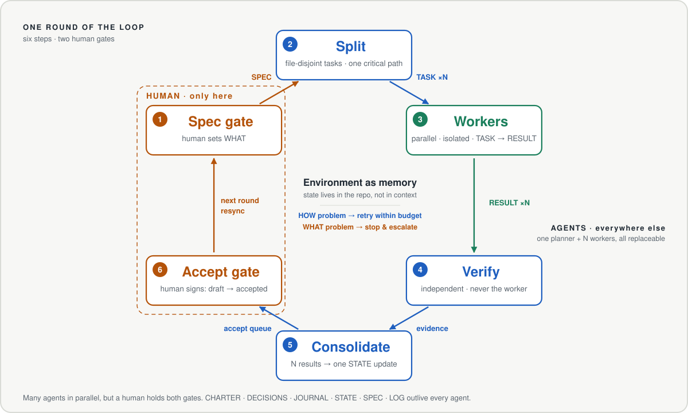
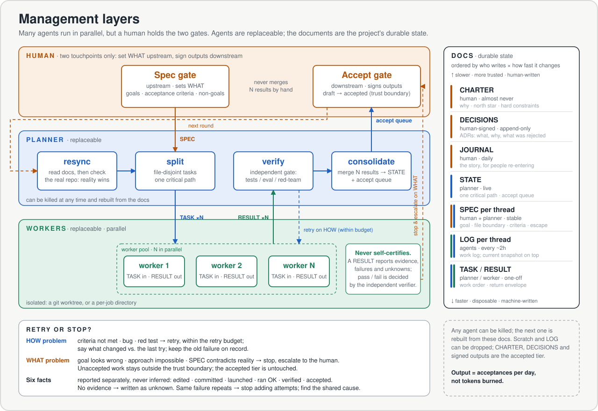

<h1 align="center">SuperSwarm Harness</h1>

<p align="center"><strong>Let the swarm work. Keep two gates.</strong><br/><em>Environment as memory, not context as memory.</em></p>

<p align="center">
  <a href="README.md">English</a> | <a href="README_zh.md">中文</a>
</p>

An agent harness runs one agent's loop. **SuperSwarm Harness runs the project around many agents**: what to work on, who does it, how results are verified, and what a human signs off. It is a set of plain Markdown docs, a planner/worker loop, and Agent Skills. There is no runtime and no service; it works with Claude Code, Codex, or any coding agent that can read files.

<p align="center">
  
</p>

> [!IMPORTANT]
> **Install with your agent.** Paste this into Claude Code, Codex, or Cursor:
> ```
> Install SuperSwarm Harness from https://github.com/cogito233/superswarm-harness — follow its INSTALL.md.
> ```
> **Then try:**
> ```
> Set up superswarm in this repo.
> ```
> ```
> Run the superswarm loop on thread T1: split it, dispatch workers, verify, and consolidate.
> ```
> ```
> What's in the accept queue? Red-team the top item before I sign.
> ```

## Core idea: Environment as Memory

The old pattern was **context as memory**: keep the project in the agent's context window and chat history, then compact it, summarize it, and hope. That breaks after a few weeks, and it breaks the moment you run more than one agent.

SuperSwarm Harness uses **environment as memory**. What the project knows lives in the repo: CHARTER, STATE, DECISIONS, a SPEC and LOG per thread, git history, and run outputs. Every agent reads the environment at the start of a round and writes back to it at the end. That makes agents replaceable, lets parallel workers share one truth, and lets you come back after two weeks without re-reading the code.

## Why

Agents are cheap. You can run ten in parallel. Running ten is not the hard part. The hard part is that **you** have to know what is true afterwards:

- **Your attention is the bottleneck, not the model.** People can actively track about 3–5 workstreams.
- **Proxies get gamed.** "Tests pass" can mean a test was deleted. Closed-loop "iterate until green" converges on the wrong target, and you are outside the loop.
- **Context rots.** After a few weeks, nobody (human or agent) can rebuild why things are the way they are from chat history.

SuperSwarm Harness answers this with two loops:

| Loop | Who closes it | How |
|---|---|---|
| **HOW** (inner) | machines | acceptance criteria + independent verification + retry budget |
| **WHAT** (outer) | the human | write the SPEC (spec gate) + accept outputs (accept gate) |

The **docs are the dashboard**. CHARTER, STATE, DECISIONS, JOURNAL, and a SPEC + LOG per thread let any agent be killed and rebuilt, and let you keep a grip on the project without re-reading it. Throughput is measured as **outputs accepted per day**, not tokens burned.

<p align="center">
  
</p>

## What's inside

| Skill | Use it when |
|---|---|
| [`superswarm-setup`](skills/superswarm-setup/SKILL.md) | Starting a project, or adding the harness to an existing repo. It inventories existing docs and creates only the missing ones. |
| [`superswarm-loop`](skills/superswarm-loop/SKILL.md) | Running a planner cycle: resync → one critical path → split into file-disjoint tasks → workers → independent verify → consolidate into STATE. |
| [`superswarm-accept`](skills/superswarm-accept/SKILL.md) | Before you sign: it checks evidence, red-teams the output, and gives you a one-screen brief. The agent never accepts for you. |
| [`superswarm-complexity-audit`](skills/superswarm-complexity-audit/SKILL.md) | The system "works" but you are babysitting it. It sorts the complexity into essential, accidental, speculative, or control debt. |
| [`superswarm-paper`](skills/superswarm-paper/SKILL.md) | Writing a research or benchmark paper with coding agents: a pre-submission editing pass. |

- **[MANUAL.md](MANUAL.md)**: the full operating manual (why each rule exists, profiles, doc hygiene, how project rules flow back upstream).
- **Profiles**: `research` · `experiments` · `product-eng` · `solo`. The core loop is the same in all of them; what "accept" means changes (finding → accepted, run → current best, branch → main).

## Rules that do the most work

1. **Two human gates only.** The human writes the SPEC and accepts outputs. Everything in between belongs to the planner.
2. **The worker never certifies itself.** Verification is a separate step done by someone else.
3. **Six facts, reported separately**: edited, committed, launched, ran OK, verified, accepted. Anything without evidence is written as `unknown`.
4. **One critical path per cycle.** Many agents is fine. Many competing finish lines is not.
5. **Retry HOW, stop on WHAT.** Execution bugs get retried within budget. A wrong plan gets escalated right away.
6. **Suggestions are not authorization.** A task can't create or widen what the human authorized.

## How it relates to other approaches

| | Focus |
|---|---|
| Agent harnesses (Claude Code, Codex, DeepSeek Harness…) | Running one agent's loop well: tools, context, sandbox |
| Runtime multi-agent systems (e.g. DeepSeek's Super-agent, Oct 2026) | Scheduling: always-on router + parallel workers + events |
| Single-agent repo harnesses | Resuming one agent across sessions; verify before "done" |
| **SuperSwarm Harness** | **The project layer: what gets trusted and who signs, plus state that survives months** |

These approaches work well together. Super-agent's authors list long-term context recovery and approval flows as open problems, and those are exactly the parts this repo is about. *Not affiliated with DeepSeek.*

## Where it fits

It fits work that can be **split, is cheap to execute, can be verified and rolled back, and runs at your pace**: software and computational research (ML, benchmarks, data, simulation). It does not fit one-off chores. Don't use it when you already know the answer and there is only one result to merge.

## History

This started as a private operating manual in June 2026 and has been used on long-running research-benchmark and ML-experiment projects. v3.0.0 is the first public release: an English main version, plain vocabulary, and the manual packaged as Agent Skills. See [CHANGELOG.md](CHANGELOG.md) and [DECISIONS.md](DECISIONS.md). The original Chinese manual is kept in [docs/zh/](docs/zh/).

## License

MIT
