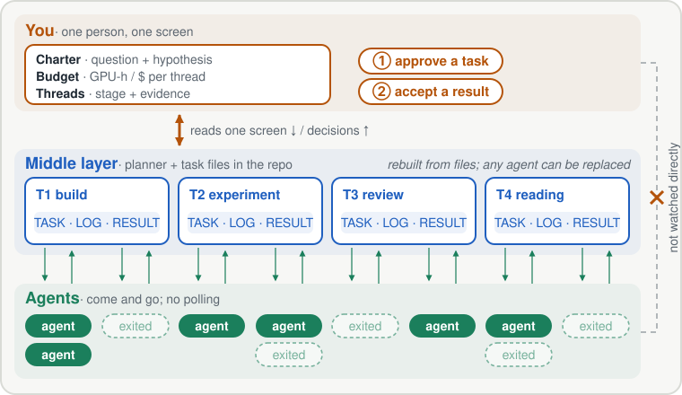
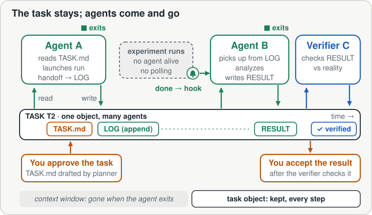

<h1 align="center">Swarm Oversight Harness</h1>

<p align="center"><strong>一个人监管多个 agent，跑一个持续数月的项目。</strong></p>

<p align="center">
  <a href="README.md">English</a> | <a href="README_zh.md">中文</a>
</p>

**背景与动机：** [Toward Human-in-the-Loop Oversight for Long-Horizon Agent Projects](https://cogito233.github.io/blog/human-in-the-loop-oversight/)（博客）。

同时跑十个 agent 不难，难的是让它们在同一个项目上干三个月。几周之后，瓶颈变成了你自己都说不清项目里哪些东西是真的。Swarm Oversight Harness 在你和 agent 之间加了一个中间层。你只看一屏，只做两类决定。中间层由仓库里的任务文件和维护这些文件的 planner agent 组成：它把你的决定变成交给许多短命 agent 的活，再把它们的产出汇总回那一屏。

它由一套纯 Markdown 文档和一组 Agent Skills 组成：仓库里的任务文件，加上一个负责维护这些文件的 planner agent。没有运行时，也不是服务，Claude Code、Codex 或任何能读文件的 coding agent 都能用。

<p align="center">
  
</p>

> [!IMPORTANT]
> **让你的 agent 来安装**，把下面这句贴给 Claude Code / Codex / Cursor：
> ```
> Install Swarm Oversight Harness from https://github.com/cogito233/swarm-oversight-harness — follow its INSTALL.md.
> ```
> **装好后试试：**
> ```
> 在这个仓库里 set up swarm oversight。
> ```
> ```
> 推进 T1：让 planner 拆分、派活、验证，再更新 STATE。
> ```
> ```
> 验收队列里有什么？我签字前先 red-team 排第一的那个。
> ```

## 你看什么，你决定什么

你对项目的全部认识放得进一屏，分三块：

- **Charter**：项目要回答的问题，以及一个假设，它的结果会改变你的计划。
- **预算**：每条线能花多少 GPU 小时和 API 费用，超了就得回来问你。
- **各条线（threads）**：每条线在做什么，有证据支撑的阶段到了哪一步，在等什么。

示例（虚构，不是真实项目）：

```
CHARTER  Can a 7B model learn to check its own patches with repo tests?
         H1: training on fail→pass test pairs adds ≥10 points of
             self-check accuracy on held-out repos.
         Kill if the 200-task pilot gains < 3 points.
BUDGET   2,000 GPU-h + $1,500 API in total. Over a thread's cap → ask.

STATE    critical path: T2 pilot result
  T1 build    fail→pass pipeline    verified, CI #41    40/100 GPU-h   → accept gate
  T2 run      SFT pilot, 200 tasks  launched, no agent  310/400 GPU-h  → done hook
  T3 review   red-team T1 leakage   running             $90/$200
  T4 read     related-work map      draft               $15/$50
```

在这一屏上，你只做两类决定：

1. **批准任务**：planner 起草好任务，你确认它为什么做、做到什么算完、最多能花多少。
2. **验收结果**：verifier 重跑过检查之后，你决定接受。从这一刻起它不再是草稿，后续工作可以在它上面接着做。

这一屏以下的东西都是写给 agent 看的。只有在做这两类决定需要时，你才打开某个任务的文件。

## 以任务为单位

单个 agent 好理解，因为它有一条线性的历史，但上下文窗口一结束，这条历史就没了。中间层把历史存进任务里。任务是仓库里一个小而持久的对象：

- `TASK.md`：目标；能改和不能碰的文件；授权范围和预算；验收标准及每条怎么检查；停止条件；
- 一份只追加、不改写的 `LOG`，顶部是当前状态快照；
- 带证据的 `RESULT` 文件；
- `STATE` 里的一行，也就是上面那一屏。

agent 接上一个任务，做完自己那部分就退出。任何 agent 都能从上一个停下的地方接着做，因为需要的东西都在任务文件里。

<p align="center">
  
</p>

**启动长实验的 agent 直接退出，不轮询。** 退出前，它在任务的 LOG 里追加一段交接：启动了什么，产出会出现在哪里，怎么检查。实验结束由完成 hook 或标记文件通知，再由新的 agent 接手这个任务。

planner 负责维护中间层。每一轮它重读仓库，把 STATE 里和实际不符的地方改掉，定一条关键路径，把工作拆成互不碰同一文件的任务，派给 worker，让结果经过验证，最后汇总成一次 STATE 更新。

## 记忆：信什么，清什么

把记忆放进文件，前提是文件本身可信。仓库里的每一份记忆都属于下面四类之一：

| 类型 | 例子 | 能当作什么 | 怎么维护 |
|---|---|---|---|
| 当前（Current） | `STATE`、`CHARTER`、未关闭的 `TASK.md` | 现在什么是真的 | 覆盖更新；每轮和实际情况核对 |
| 历史（History） | `LOG` 条目、旧的 `RESULT`、`DECISIONS` | 发生过什么 | 只追加，从不修改 |
| 过期（Stale） | 比它描述的代码更旧的文档；被取代的计划 | 重新核对前什么都不算 | 标为过期，不默认信任 |
| 可丢弃（Disposable） | scratch 文件、agent 的上下文、未验收的草稿 | 什么都不算 | 随时删除 |

清理由 planner 在每轮开头做。STATE 和 git、测试、运行产出对不上时，以仓库为准，改 STATE。被取代的计划移入历史，并注明被什么取代。只存在于某个 agent 上下文里的东西一律当作已经丢失，因为那个 agent 迟早会退出。

## 最承重的几条规则

1. **人只做两类决定**：批准任务，验收结果。中间全部归 planner。
2. **干活的不给自己盖章**：由独立的 verifier 重跑任务里写明的检查，把看到的和声称的对照。
3. **六个事实分开报**：修改、提交、启动、运行成功、独立验证、验收。没有证据的一律写 `unknown`。
4. **每轮只有一条关键路径**：agent 多没关系，终点不能多。
5. **HOW 问题在预算内重试，WHAT 问题立刻停**：测试失败就在预算内重试；计划和实际矛盾，或者某条线快要超出预算上限，马上上报给你。
6. **建议不等于授权**：任务不能自己创造或扩大你给的授权，预算也属于授权的一部分。
7. **死路要记下来**：被否掉的假设连同理由写进 DECISIONS，后来的 agent 就不会再走一遍。

## 里面有什么

| Skill | 什么时候用 |
|---|---|
| [`swarm-setup`](skills/swarm-setup/SKILL.md) | 起新项目，或者给已有仓库补上这套流程。它先盘点已有文档，只创建缺的那些。 |
| [`swarm-loop`](skills/swarm-loop/SKILL.md) | 跑一轮 planner 闭环：核对现状 → 定一条关键路径 → 按文件拆成互不重叠的任务 → workers 并行 → 独立验证 → 汇总进 STATE。 |
| [`swarm-accept`](skills/swarm-accept/SKILL.md) | 你签字之前用：核对证据、red-team，给你一屏的简报。agent 永远不替你验收。 |
| [`swarm-complexity-audit`](skills/swarm-complexity-audit/SKILL.md) | 系统"能跑"但你得一直盯着的时候用：判断哪些复杂度是必要的、偶然的、过早泛化的，哪些是控制面债务。 |
| [`swarm-paper`](skills/swarm-paper/SKILL.md) | 用 coding agent 写研究或 benchmark 论文时，做投稿前的编辑 pass。 |

完整说明见 **[MANUAL.md](MANUAL.md)**（英文正本），原始中文版见 [docs/zh/](docs/zh/)。

## 相关工作

- **Anthropic，[Effective harnesses for long-running agents](https://www.anthropic.com/engineering/effective-harnesses-for-long-running-agents)**（2025-11）。用一个 initializer agent、一份进度文件和 git 历史，让单个 coding agent 跨上下文窗口接着干。这是单 agent 版本的"环境即记忆"。本仓库把它扩展到多个 agent，并加上人的两类决定。
- **Zhan 等，[Agensh: Scaling Organizational Intelligence to 1,024 Agents](https://arxiv.org/abs/2609.26781)**（arXiv 2609.26781）。任务是共享工作区里可以认领的对象，去中心化的团队扩展到 1,024 个 agent。
- **Cao 等，[Evolving Agent Teams](https://www.alphaxiv.org/abs/2610.36848)**（arXiv 2610.36848，2026-10）。supervisor 判断团队何时卡在局部最优，并重组团队。各团队共享一个持久的文件系统 harness，包括一份 learning 文档和一份演化历史。他们让 supervisor 自动重组；本仓库让 planner 做日常工作，WHAT 层面的决定留给人。
- **Shah 等，[GitSwarm: Decentralized Compounding Inference](https://arxiv.org/abs/2610.04862)**（arXiv 2610.04862）。同构 agent 通过共享的持久记忆，在彼此的中间成果上继续推进。
- **Park & Choi，[When Do Agent Loops Mistake Stagnation for Progress?](https://arxiv.org/abs/2607.25152)**（arXiv 2607.25152）。自己给自己打分的 agent 会把没有改进的结果当成进展（"progress mirage"），只有基于外部事实的验证能纠正。这是"干活的不给自己盖章"的实证依据。
- **DeepSeek，[Super-agent 设计 + dsh-superagent 原型](https://github.com/deepseek-ai/dsh-superagent-prototype)**（2026-10）。请求驱动：常驻 router、带授权范围的工单、并行 executor，服务一个团队的 GitHub 和聊天。和本仓库互补：他们用代码强制授权，本仓库管目标驱动的项目层。*与 DeepSeek 无关联。*
- **[Bow-Lin/project-harness](https://github.com/Bow-Lin/project-harness)**：单 agent 的操作手册，让仓库可恢复、可验证。**[MindOS](https://github.com/GeminiLight/MindOS)**：本地知识库，在多个 agent 之间共享个人上下文。

Anthropic 的 harness、Agensh、Evolving Agent Teams 和 GitSwarm 都没有把"谁验证结果"和"谁决定结果算数"分开，本仓库补的正是这一块。这些条目的 BibTeX 见 [docs/references.bib](docs/references.bib)。

## 局限

- **不是运行时**：没有调度器，也没有常驻进程。需要一个常驻、接收团队聊天和 GitHub 请求的 agent，可以看 DeepSeek 的 Super-agent 原型。
- **是协议，不是强制**：规则成立，靠的是 agent 读了并且照做。执行层的强制约束是另一件事，可以交给 [agentsh](https://github.com/canyonroad/agentsh) 这类工具。
- **杂活别用**：已经知道答案、结果只有一路要合并的，直接让 agent 做。它适合拆得开、执行便宜、可验证、可回退的工作，主场是软件和计算型研究（ML、benchmark、数据、仿真）。
- **一个人的实践**：这套方法来自一个人在自己的研究项目上约四个月的使用，不是对照研究。它未必适用于团队协作、动作不可撤销的工作，或者难点在于等别人的项目。

## 引用

```bibtex
@software{swarmoversight2026,
  title   = {Swarm Oversight Harness: Toward Human-in-the-Loop Oversight for Long-Horizon Agent Projects},
  author  = {cogito233},
  year    = {2026},
  version = {3.0.0},
  url     = {https://github.com/cogito233/swarm-oversight-harness}
}
```

## 来历

这套东西 2026 年 6 月起是我的私人操作手册，在长期的研究 benchmark 项目和 ML 实验项目里实际用过。v3.0.0 是第一个公开版本：改成英文正本，用词简化，封装成 Agent Skills。版本记录见 [CHANGELOG.md](CHANGELOG.md) 和 [DECISIONS.md](DECISIONS.md)。

## License

MIT
